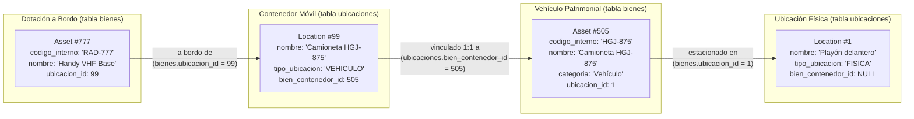
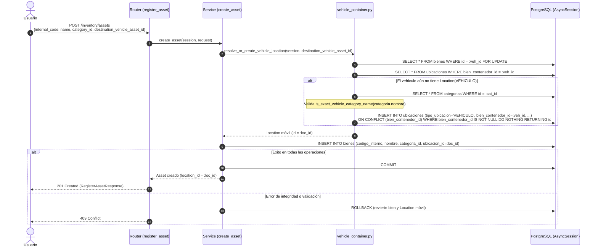
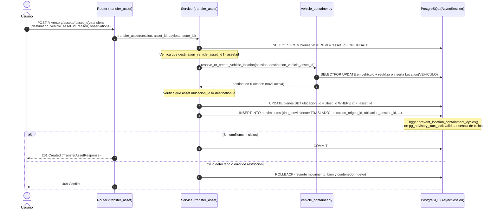
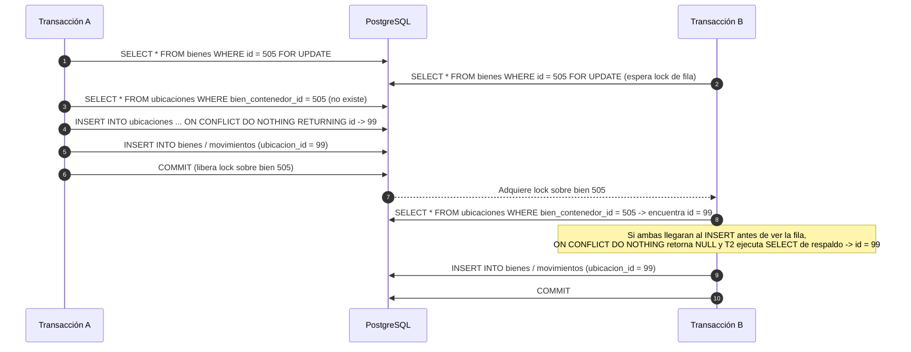

# Arquitectura actual del backend

El backend actual es una aplicación FastAPI que registra los routers de inventario y autenticación, y sirve la web en el mismo origen. Esta página describe **cómo funciona hoy**; [ADR-001](../adr/ADR-001-backend-architecture.md) explica la organización inicial del inventario, [ADR-005](../adr/ADR-005-email-password-authentication.md) la autenticación y [ADR-007](../adr/ADR-007-automatic-vehicle-containers.md) la habilitación automática y transaccional de vehículos como contenedores móviles.

## Flujo de una petición de inventario

```text
HTTP → FastAPI (`app/main.py`) → router de inventario
     → `require_authenticated_user` → schema Pydantic → `get_database_session`
     → servicio de aplicación (`register_asset`, `transfer_asset`, `update_asset`)
     → `resolve_or_create_vehicle_location` (cuando el destino es un vehículo)
     → `AsyncSession` / modelo SQLAlchemy → PostgreSQL
```

El alta de bienes (`app/modules/inventory/register_asset/service.py`) resuelve la categoría (existente o nueva) y la ubicación de destino (física o vehicular) y persiste todos los cambios en una única transacción. El traslado de bienes (`app/modules/inventory/transfer_asset/service.py`) bloquea el bien, resuelve o crea automáticamente el contenedor móvil cuando el destino es un vehículo patrimonial (`app/modules/inventory/shared/vehicle_container.py`), actualiza `bienes.ubicacion_id` y registra la fila `TRASLADO` en `movimientos` dentro de la misma transacción. La edición (`app/modules/inventory/update_asset/service.py`) bloquea el bien y confirma el cambio junto con una fila en `auditoria_cambios`. Los routers conservan el mapeo HTTP. La sesión se crea en `app/infrastructure/database/session.py` a partir de la URL cargada por `app/config/settings.py`.

Los seis routers de inventario declaran la misma dependencia `app/modules/auth/dependencies.py::require_authenticated_user`, aplicada a sus doce endpoints. El helper valida la cookie local de 30 minutos y confirma que el usuario todavía existe mediante la misma `AsyncSession` de la petición; una sesión ausente, inválida, expirada o perteneciente a un usuario eliminado devuelve `401` con `error.code = AUTH_REQUIRED`. Para continuar exige `usuarios.activo = true` y un rol activo cuyo nombre sea `ADMINISTRADOR` o `SUPERVISOR`. Una cuenta autenticada sin rol, inactiva o con un rol no permitido recibe `403` con `error.code = INVENTORY_ACCESS_DENIED`. Ambos roles tienen acceso completo a las rutas de inventario actuales. El traslado y la edición reciben además el usuario autorizado para atribuir el cambio, sin repetir la consulta gracias al caché de dependencias de FastAPI.

La autenticación separa router (`app/modules/auth/router.py`), reglas de registro/login (`service.py`), schemas (`schemas.py`), modelo `User` (`models.py`) y validadores reutilizables (`validations/`). Las invitaciones y solicitudes de acceso separan emisión HTTP, políticas, flujos y adaptación Gmail en `app/modules/auth/invitations/`. Hash Argon2 y verificación se ejecutan en threadpool. Alembic crea las tablas; ningún dato de PostgreSQL llega mediante `git pull`.

### Estructura implementada: rol y estado del usuario

El [modelo físico](../../Phase_01/data-modeling/guie.md#3-tabla-roles) incluye el catálogo `roles` y los campos `usuarios.rol_id` y `usuarios.activo`. La revisión `e7d4c2f9a621` y el modelo `User` incorporan esta estructura. Cada integrante debe confirmar su base de destino antes de aplicar la migración.

| Elemento implementado | Transición compatible |
|---|---|
| `roles` | Catálogo con `id`, `nombre` único, `descripcion`, `activo`, `created_at` y `updated_at`. La migración siembra únicamente `ADMINISTRADOR` y `SUPERVISOR`; sembrar el catálogo no asigna privilegios a ninguna cuenta. |
| `usuarios.rol_id` | Clave foránea nullable a `roles.id`. Las cuentas existentes conservaron su valor durante la migración; las cuentas nuevas reciben el rol de su invitación consumida. No existe rol predeterminado implícito. |
| `usuarios.activo` | Booleano no nulo con valor predeterminado `true`, para conservar activas las cuentas existentes durante la migración. |
| `usuarios.password_hash` | Permanece nullable: las cuentas creadas solo con Google no tienen contraseña local. |

El guard de inventario comprueba `rol_id` y `activo`. El registro abierto quedó cerrado: una cuenta nueva debe consumir una invitación válida y obtiene su rol en la misma transacción que el alta. Las cuentas existentes siguen iniciando sesión con sus datos anteriores. En la base de prueba local se asignaron manualmente los usuarios elegidos por el responsable del proyecto; esta asignación de datos no viaja mediante Git.

El requisito RNF-SEG-02 menciona además la función de carga; queda pendiente de revisión para una fase posterior. Por decisión actual del equipo, el catálogo inicial contiene solo `ADMINISTRADOR` y `SUPERVISOR`.

Google agrega `google_oauth.py` para el proveedor, `google_service.py` para las reglas de cuentas y `validations/google_flow.py` para el estado efímero firmado. El flujo es código de autorización en el servidor; JavaScript no recibe tokens Google. Véase [ADR-006](../adr/ADR-006-google-oauth-identity.md).
`google_observability.py` registra eventos JSON con `attempt_id`, etapa, resultado y motivo controlado, sin secretos ni datos de identidad. Los scripts de desarrollo ejecutan Uvicorn con `--no-access-log`, porque la URL del callback contiene `code` y `state`; SQLAlchemy también evita imprimir parámetros. Véase la [guía de diagnóstico](../../getting-started/google-oauth.md#diagnóstico-seguro-en-la-terminal).

---

## Arquitectura de inventario: Bienes, Ubicaciones y Vehículos

El modelo de inventario implementado en `app/modules/inventory/shared/models.py` distingue cuatro conceptos complementarios sobre las tablas `bienes` (`Asset`), `categorias` (`Category`) y `ubicaciones` (`Location`):

### 1. Bien patrimonial (`Asset` — tabla `bienes`)
Representa un elemento inventariable con identidad propia (`id`), código interno único (`codigo_interno`), denominación (`nombre`), categoría obligatoria (`categoria_id` → `categorias.id`) y ubicación actual opcional (`ubicacion_id` → `ubicaciones.id`). Cuando `ubicacion_id` es `NULL`, el bien se considera en depósito sin asignación fija.

### 2. Ubicación física (`Location` con `tipo_ubicacion = 'FISICA'` — tabla `ubicaciones`)
Representa un lugar físico real donde pueden encontrarse o estacionarse bienes patrimoniales, tales como depósitos, oficinas, salas técnicas, cuarteles o playones (por ejemplo, `Cuartel Central` o `Playón delantero`). Una ubicación física tiene siempre `bien_contenedor_id = NULL`.

### 3. Vehículo patrimonial (`Asset` perteneciente a categoría vehicular)
Es un bien patrimonial registrado en la tabla `bienes` (por ejemplo, `Camioneta HGJ-875` con `codigo_interno = 'HGJ-875'`) que posee su propia ubicación física de estacionamiento a través de `bienes.ubicacion_id` (por ejemplo, apunta a la ubicación `FISICA` `Playón delantero`).

### 4. Vehículo como contenedor móvil (`Location` con `tipo_ubicacion = 'VEHICULO'`)
Es una fila en la tabla `ubicaciones` con `tipo_ubicacion = 'VEHICULO'` vinculada de forma unívoca al bien patrimonial del vehículo mediante `ubicaciones.bien_contenedor_id = bienes.id`. Esta ubicación móvil se utiliza como destino en `bienes.ubicacion_id` de las herramientas, equipos de radio, botiquines o insumos transportados a bordo de esa unidad.

> **Separación entre estacionamiento físico y dotación transportada:** Un vehículo patrimonial puede estar estacionado en `Playón delantero` (`camioneta.ubicacion_id = playon.id`) y, simultáneamente, contener su propio equipamiento a bordo (`handy.ubicacion_id = ubicacion_movil_camioneta.id`, donde `ubicacion_movil_camioneta.bien_contenedor_id = camioneta.id`). Asignar o trasladar equipamiento hacia el vehículo modifica el `ubicacion_id` del equipamiento, pero **nunca altera** el `ubicacion_id` donde está estacionado el vehículo.

---

## Automatización transparente de contenedores vehiculares

El personal operativo no necesita crear ni habilitar manualmente una ubicación móvil antes de cargar equipamiento en un vehículo. El flujo implementado en `app/modules/inventory/shared/vehicle_container.py`, `register_asset/service.py` y `transfer_asset/service.py` opera de manera completamente automática al confirmar el guardado:

1. El usuario registra un bien nuevo (`POST /inventory/assets`) o traslada un bien existente (`POST /inventory/assets/{asset_id}/transfers`).
2. En el formulario selecciona como destino una ubicación existente (`location_id` / `destination_location_id`) o un vehículo patrimonial (`destination_vehicle_asset_id`).
3. El backend identifica el tipo de destino recibido en el schema Pydantic validando que ambos campos sean mutuamente excluyentes.
4. Si el destino es un vehículo (`destination_vehicle_asset_id`), `resolve_or_create_vehicle_location(session, vehicle_asset_id)` bloquea la fila del vehículo (`SELECT ... FOR UPDATE`) y busca si ya existe una fila en `ubicaciones` con `bien_contenedor_id == vehicle_asset_id`:
   - Si el vehículo **ya tiene contenedor móvil**, verifica que esté activo (`activa == True`) y lo reutiliza.
   - Si el vehículo **todavía no tiene contenedor móvil**, verifica que su categoría sea elegible (`is_exact_vehicle_category_name(category.nombre)`) y crea automáticamente la fila `Location(tipo_ubicacion="VEHICULO", bien_contenedor_id=vehicle_asset.id, nombre=vehicle_asset.nombre, descripcion=f"Unidad móvil ({vehicle_asset.codigo_interno})", activa=True)` sin confirmar aún la transacción.
5. El servicio registra el bien o ejecuta el traslado asignándole el `id` de la ubicación móvil resuelta o recién creada.
6. Todas las operaciones se confirman en una **única transacción** (`await session.commit()`) o se revierten por completo (`await session.rollback()`) ante cualquier error de validación o restricción.

No se realizan escrituras en la base de datos durante consultas `GET`, al abrir formularios ni al cambiar selecciones en los desplegables del frontend. Tampoco se muestran pasos intermedios de configuración ni avisos técnicos al usuario.

---

## Integridad y concurrencia

La consistencia del inventario se apoya en tres niveles complementarios: restricciones en PostgreSQL, lógica transaccional en servicios y validaciones tempranas en el frontend.

### 1. Garantías en la base de datos (PostgreSQL)

Definidas en `migrations/versions/e42c7910b6af_add_inventory_locations.py`, `a6a239f7b4dc_add_inventory_movements.py` y `b3f81e7d2c94_add_location_cycle_trigger_concurrency_lock.py`:

- **Coherencia por tipo de ubicación (`ck_ubicaciones_tipo_ubicacion` y `ck_ubicaciones_contenedor_por_tipo`):**
  - `tipo_ubicacion` solo admite `'FISICA'` o `'VEHICULO'`.
  - Si `tipo_ubicacion = 'FISICA'`, exige `bien_contenedor_id IS NULL`.
  - Si `tipo_ubicacion = 'VEHICULO'`, exige `bien_contenedor_id IS NOT NULL`.
- **Unicidad de contenedor móvil por vehículo (`uq_ubicaciones_bien_contenedor_id`):**
  - Índice único parcial `CREATE UNIQUE INDEX uq_ubicaciones_bien_contenedor_id ON ubicaciones (bien_contenedor_id) WHERE bien_contenedor_id IS NOT NULL`. Impide que un mismo bien vehicular tenga más de una ubicación móvil asociada.
- **Integridad referencial:**
  - `bienes.ubicacion_id → ubicaciones.id` (`ON DELETE SET NULL`).
  - `ubicaciones.bien_contenedor_id → bienes.id` (`ON DELETE RESTRICT`).
  - `movimientos.bien_id → bienes.id`, `movimientos.usuario_id → usuarios.id`, `movimientos.ubicacion_origen_id → ubicaciones.id` y `movimientos.ubicacion_destino_id → ubicaciones.id` (`ON DELETE RESTRICT`).
- **Prevención de ciclos de contención y serialización en base de datos (`prevent_location_containment_cycles`):**
  - Los triggers `trg_bienes_location_cycle` (`AFTER INSERT OR UPDATE OF ubicacion_id ON bienes`) y `trg_ubicaciones_location_cycle` (`AFTER INSERT OR UPDATE OF bien_contenedor_id ON ubicaciones`) ejecutan la función PL/pgSQL `prevent_location_containment_cycles()`.
  - La revisión `b3f81e7d2c94` exige nivel de aislamiento `READ COMMITTED` (`ERRCODE = '0A000'` si difiere) y adquiere el bloqueo consultivo transaccional `pg_advisory_xact_lock(hashtext('prevent_location_containment_cycles'))`, serializando las escrituras del grafo de contención entre transacciones concurrentes antes de evaluar la consulta recursiva `WITH RECURSIVE paths`. Si detecta autoubicación (`A → loc(A)`) o ciclos indirectos (`A → loc(B) → B → loc(A)`), aborta con `ERRCODE = '23514'`.
- **Validez de traslados (`ck_movimientos_traslado_destino`):**
  - Exige que todo movimiento con `tipo_movimiento = 'TRASLADO'` tenga `ubicacion_destino_id IS NOT NULL` y `ubicacion_origen_id IS DISTINCT FROM ubicacion_destino_id`.

### 2. Garantías en la capa de servicios (`app/modules/inventory/`)

- **Atomicidad transaccional y rollback:** `create_asset`, `transfer_asset` y `update_asset` ejecutan todas sus lecturas con bloqueo e inserciones antes de un único `await session.commit()`. Ante cualquier excepción (`IntegrityError` o error de negocio), ejecutan explícitamente `await session.rollback()`, garantizando que un alta o traslado fallido jamás deje creada una ubicación móvil huérfana ni una categoría sin bien.
- **Uso de `SELECT ... FOR UPDATE`:**
  - `transfer_asset` bloquea la fila del bien que se traslada (`select(Asset).where(Asset.id == asset_id).with_for_update()`).
  - `resolve_or_create_vehicle_location` bloquea la fila del bien vehículo destino (`select(Asset).where(Asset.id == vehicle_asset_id).with_for_update()`).
- **Resolución de conflictos concurrentes sin abortar la transacción:**
  - Al crear un contenedor móvil faltante, `resolve_or_create_vehicle_location` ejecuta `insert(Location).values(...).on_conflict_do_nothing(index_elements=[Location.bien_contenedor_id], index_where=text("bien_contenedor_id IS NOT NULL")).returning(Location.id)`.
  - Si dos peticiones concurrentes compiten por habilitar el mismo vehículo, la sentencia `ON CONFLICT DO NOTHING` evita que PostgreSQL invalide la transacción perdedora con un error `23505`; cuando `returning(Location.id)` devuelve `None`, la función consulta y retorna la ubicación recién insertada por la transacción ganadora.
- **Elegibilidad de vehículos (`is_exact_vehicle_category_name`):**
  - Cuando el bien destino aún no tiene ubicación móvil, el servicio normaliza el nombre de su categoría en NFD (eliminando marcas diacríticas), convierte a minúsculas y exige coincidencia exacta con `"vehiculo"` o `"vehiculos"`. Si no cumple, lanza `IneligibleVehicleAssetError` (`409`), impidiendo que un bien común (como un botiquín o una herramienta) sea convertido en contenedor vehicular.
- **Preservación de la ubicación física del vehículo:**
  - `resolve_or_create_vehicle_location` solo lee `vehicle_asset` e inserta/consulta en `ubicaciones`; no modifica `vehicle_asset.ubicacion_id`.
- **Alcance de reutilización frente a idempotencia general:**
  - La reutilización sin duplicados está garantizada para el contenedor móvil del vehículo (`resolve_or_create_vehicle_location`) y para la categoría por nombre exacto (`_resolve_category_id`).
  - Los endpoints de inventario (`POST /inventory/assets`, `POST /inventory/assets/{asset_id}/transfers`, `POST /inventory/locations`) **no implementan idempotencia general de petición**: repetir un traslado hacia otra ubicación generará un nuevo movimiento o un conflicto `409` (`SameLocationError`), y repetir un alta con el mismo `internal_code` devolverá `409`.

### 3. Validaciones en el frontend (`frontend/js/app.js`)

- Excluye del selector `#mover-destino-select` la ubicación actual del bien (`excludeLocationId`) y, si el bien que se traslada es un vehículo, excluye al propio vehículo y a su contenedor móvil (`excludeAssetId`) para prevenir autoubicación desde la interfaz.
- Valida longitudes mínimas (3 caracteres en código interno, nombre de bien, categoría y ubicación) y bloquea el botón de envío mientras la petición HTTP está en curso.

---

## Diagramas técnicos

### 1. Modelo conceptual Bien–Ubicación–Vehículo



### 2. Flujo transaccional de registro de bienes (`POST /inventory/assets`)



### 3. Flujo de traslado hacia un vehículo (`POST /inventory/assets/{asset_id}/transfers`)



### 4. Resolución concurrente de contenedores móviles



---

## Rutas registradas y contratos de API

| Método y ruta | Módulo | Respuesta principal |
|---|---|---|
| `POST /inventory/categories` | `register_category` | `201`, `CategoryResponse` |
| `GET /inventory/categories` | `register_category` | `200`, lista de `CategoryResponse` ordenada por ID |
| `POST /inventory/assets` | `register_asset` | `201`, `RegisterAssetResponse` |
| `GET /inventory/assets/` | `get_asset` | `200`, lista de `RegisterAssetResponse` ordenada por ID |
| `GET /inventory/assets/{asset_id}` | `get_asset` | `200` con el bien o `404` |
| `PATCH /inventory/assets/{asset_id}` | `update_asset` | `200` con el bien editado, `404` si no existe |
| `POST /inventory/assets/{asset_id}/transfers` | `transfer_asset` | `201`, `TransferAssetResponse` |
| `GET /inventory/assets/{asset_id}/transfers` | `transfer_asset` | `200`, lista de `TransferAssetResponse` ordenada por fecha e ID |
| `GET /inventory/movements` | `transfer_asset` (`router_movements`) | `200`, lista general de `MovementItemResponse` ordenada por fecha descendente |
| `POST /inventory/locations` | `register_location` | `201`, `LocationResponse` |
| `GET /inventory/locations` | `register_location` | `200`, lista de `LocationResponse` ordenada por ID |
| `GET /inventory/locations/{location_id}` | `register_location` | `200` con la ubicación o `404` |
| `POST /auth/register` | `auth/router.py` | `201`, `message` y `user`; establece cookie de sesión |
| `POST /auth/registration-requests` | `auth/invitations/router.py` | `202`, solicitud pública de acceso recibida |
| `GET /auth/registration-requests` | `auth/invitations/router.py` | `200`, listado de solicitudes (solo revisor `ADMINISTRADOR`) |
| `POST /auth/registration-requests/{id}/review` | `auth/invitations/router.py` | `200`, aprueba o rechaza solicitud |
| `POST /auth/invitations` | `auth/invitations/router.py` | `201` tras enviar invitación; solo revisor `ADMINISTRADOR` activo |
| `GET /auth/invitations` | `auth/invitations/router.py` | `200`, listado de invitaciones emitidas |
| `POST /auth/login` | `auth/router.py` | `200`, `message` y `user`; establece cookie de sesión |
| `POST /auth/logout` | `auth/router.py` | `204`; elimina cookie del navegador |
| `GET /auth/me` | `auth/router.py` | `200`, perfil de la sesión actual (`id`, correo, nombre y rol); `401` sin sesión |
| `GET/POST /auth/google/start` | `auth/router.py` | `303` a Google con estado, PKCE y nonce |
| `GET /auth/google/callback` | `auth/router.py` | Verifica identidad y redirige con sesión local o error controlado |
| `GET /` | `app/main.py` | Dashboard con token válido; si no, `303` a `/iniciar-sesion` |
| `GET /health` | `app/main.py` | `200`, `{"status":"ok"}` (liveness) |
| `GET /health/ready` | `app/main.py` | `200` o `503`, verificación de conectividad a PostgreSQL y estado de migraciones |

Todas las rutas bajo `/inventory/...` exigen sesión autenticada con rol activo `ADMINISTRADOR` o `SUPERVISOR`.

### 1. Contrato de registro de bienes: `POST /inventory/assets`

Definido en `app/modules/inventory/register_asset/schemas.py` y `router.py`:

- **Campos de entrada (`RegisterAssetRequest`):**
  - `internal_code` (`str`, obligatorio, 3–30 caracteres).
  - `name` (`str`, obligatorio, 3–150 caracteres).
  - **Categoría (exclusión mutua obligatoria):** se debe enviar exactamente uno de:
    - `category_id` (`int > 0`): ID de una categoría existente.
    - `new_category_name` (`str`, 3–100 caracteres): nombre de categoría a crear o reutilizar atómicamente.
  - **Destino inicial (opcional, con exclusión mutua):** se puede omitir ambos (queda en depósito con `location_id = null`) o enviar **como máximo uno** de:
    - `location_id` (`int > 0`): ID de una ubicación existente activa (`FISICA` o `VEHICULO`) en la tabla `ubicaciones`.
    - `destination_vehicle_asset_id` (`int > 0`): ID del bien patrimonial vehículo en la tabla `bienes`. El backend reutiliza su ubicación `VEHICULO` si ya existe o la crea automáticamente en la misma transacción.
  - Enviar simultáneamente `location_id` y `destination_vehicle_asset_id` es rechazado con `422 VALIDATION_ERROR`.

**Ejemplo A — Registro en ubicación existente (`location_id`):**

```json
{
  "internal_code": "CASCO-001",
  "name": "Casco estructural MSA",
  "category_id": 1,
  "location_id": 1
}
```

**Ejemplo B — Registro directo dentro de un vehículo patrimonial (`destination_vehicle_asset_id`):**

```json
{
  "internal_code": "RAD-777",
  "name": "Handy Motorola VHF",
  "category_id": 3,
  "destination_vehicle_asset_id": 505
}
```

**Respuesta exitosa (`201 Created` — `RegisterAssetResponse`):**

```json
{
  "id": 777,
  "internal_code": "RAD-777",
  "name": "Handy Motorola VHF",
  "category_id": 3,
  "location_id": 99
}
```
*(Donde `location_id: 99` corresponde al ID de la ubicación `VEHICULO` vinculada a `container_asset_id = 505`, creada o reutilizada en la misma transacción).*

**Errores de `POST /inventory/assets`:**
- `401`: sesión ausente, inválida o expirada (`AUTH_REQUIRED`).
- `403`: usuario sin rol activo permitido (`INVENTORY_ACCESS_DENIED`).
- `422`: falta categoría, se enviaron ambas opciones de categoría, o se enviaron simultáneamente `location_id` y `destination_vehicle_asset_id` (`VALIDATION_ERROR`).
- `409`:
  - Destino inexistente o inactivo: `"La ubicación seleccionada no existe o se encuentra inactiva."`
  - Bien indicado en `destination_vehicle_asset_id` no pertenece a una categoría vehicular elegible: `"El destino seleccionado no es válido para registrar el bien."`
  - Código interno duplicado o categoría inexistente: `"El código interno ingresado ya existe en el inventario o la categoría es inválida."`

### 2. Contrato de transferencia de bienes: `POST /inventory/assets/{asset_id}/transfers`

Definido en `app/modules/inventory/transfer_asset/schemas.py` y `router.py`:

- **Campos de entrada (`TransferAssetRequest`):**
  - **Destino (exclusión mutua obligatoria):** se debe enviar **exactamente uno** de:
    - `destination_location_id` (`int > 0`): ID de una ubicación activa en `ubicaciones`.
    - `destination_vehicle_asset_id` (`int > 0`): ID de un bien patrimonial vehículo en `bienes`.
  - `reason` (`str | None`, opcional, hasta 1000 caracteres).
  - `observations` (`str | None`, opcional, hasta 2000 caracteres).
  - No recibe usuario ni ubicación de origen desde el cliente: toma `actor_id` de la sesión autenticada y `origin_location_id` del estado actual bloqueado del bien.

**Ejemplo — Traslado de un bien hacia un vehículo patrimonial (`destination_vehicle_asset_id`):**

```json
{
  "destination_vehicle_asset_id": 505,
  "reason": "Asignación a unidad móvil",
  "observations": "Equipo verificado antes de guardia"
}
```

**Respuesta exitosa (`201 Created` — `TransferAssetResponse`):**

```json
{
  "id": 12,
  "asset_id": 601,
  "user_id": 4,
  "movement_type": "TRASLADO",
  "occurred_at": "2026-11-01T13:20:00Z",
  "origin_location_id": 1,
  "destination_location_id": 99,
  "reason": "Asignación a unidad móvil",
  "observations": "Equipo verificado antes de guardia"
}
```

**Errores de `POST /inventory/assets/{asset_id}/transfers`:**
- `404`: el bien `asset_id` no existe (`"Asset not found."`).
- `422`: no se indicó destino, o se enviaron ambos `destination_location_id` y `destination_vehicle_asset_id` (`VALIDATION_ERROR`).
- `409`:
  - El bien ya se encuentra en esa ubicación (`"The asset is already there."`).
  - La ubicación o el vehículo destino no existe o está inactivo (`"The destination is unavailable."`).
  - El bien indicado en `destination_vehicle_asset_id` no es un vehículo elegible (`"El destino seleccionado no es válido para trasladar el bien."`).
  - Intento de autoubicación o ciclo de contención directo/indirecto (`"The transfer violates inventory location constraints."`).

### 3. Contratos de consulta de movimientos y ubicaciones

- `GET /inventory/assets/{asset_id}/transfers`: devuelve `list[TransferAssetResponse]` ordenado por `fecha` e `id` para el bien consultado (`404` si el bien no existe).
- `GET /inventory/movements`: devuelve `list[MovementItemResponse]` ordenado por `fecha DESC, id DESC`, enriquecido con `asset_code`, `asset_name`, `user_email`, `origin_location_name` y `destination_location_name`.
- `POST /inventory/locations`: crea una ubicación manual (`CreateLocationRequest`: `name`, `location_type` en `{"FISICA", "VEHICULO"}`, `container_asset_id`, `description`, `active`). Exige `container_asset_id` cuando `location_type == "VEHICULO"` y lo prohíbe cuando `location_type == "FISICA"` (`422`).
- `GET /inventory/locations` y `GET /inventory/locations/{location_id}`: devuelven `LocationResponse` (`id`, `name`, `location_type`, `container_asset_id`, `description`, `active`, `created_at`, `updated_at`). Ninguna ruta `GET` realiza escrituras en la base de datos.

### 4. Edición parcial auditada: `PATCH /inventory/assets/{asset_id}`

Para corregir un bien, `PATCH /inventory/assets/{asset_id}` acepta uno o más de `internal_code`, `name` y `category_id`, además de `reason` obligatorio y no vacío. Rechaza `location_id` y campos desconocidos (`422`): la ubicación cambia solo mediante traslados. Una categoría inexistente o un código duplicado devuelve `409`. El servicio bloquea el bien y, en una transacción, escribe el cambio y una fila `CORRECCION`/`BIEN` en `auditoria_cambios`, con actor de la sesión, motivo, fecha, `operacion_id` y snapshots JSONB completos.

---

## Persistencia, pruebas y limitaciones conocidas

### Historial de migraciones Alembic

- `0374d9a573a1_create_categories_and_assets_tables.py`: crea `categorias` y `bienes`.
- `b70e8e0479aa_create_auth_users.py`, `c4e9f1d2a7b3_add_google_identity.py`, `d8b6e2f1940a_add_user_display_name.py`, `e7d4c2f9a621_add_user_roles_and_active_state.py`: estructura de `usuarios` y catálogo `roles`.
- `e42c7910b6af_add_inventory_locations.py`: crea `ubicaciones`, agrega `bienes.ubicacion_id`, restricciones de tipo/contenedor, índice único parcial `uq_ubicaciones_bien_contenedor_id` y función/triggers iniciales contra ciclos.
- `a6a239f7b4dc_add_inventory_movements.py`: crea `movimientos` con claves foráneas, `ck_movimientos_tipo_movimiento`, `ck_movimientos_traslado_destino` e índice `ix_movimientos_bien_id_fecha`.
- `c15b4e3d9a20_add_audit_changes.py`: crea `auditoria_cambios`.
- `f09a6e2112b4_add_auth_invitations.py`, `a4d9c2b7e631_add_registration_requests.py`, `f1a8c4d2e9b7_add_reissue_controls_to_registration_requests.py`: invitaciones y solicitudes de registro.
- `b3f81e7d2c94_add_location_cycle_trigger_concurrency_lock.py`: incorpora verificación `READ COMMITTED` y `pg_advisory_xact_lock` en `prevent_location_containment_cycles()`.
- `g3b7e1d5a8c2_add_idempotency_records_table.py` y `e8c91a2d3b45_create_outbox_events_table.py`: tablas de soporte para idempotencia de invitaciones y eventos outbox.

### Aislamiento de pruebas y resultados reportados

Las fixtures transaccionales de autenticación (`tests/modules/auth/conftest.py`) e inventario (`tests/modules/inventory/conftest.py`) verifican que `SELECT current_database()` sea `fireassets_test`, comparten una `AsyncSession` con FastAPI mediante `app.dependency_overrides[get_database_session]` usando `join_transaction_mode="create_savepoint"` y revierten la transacción externa al finalizar cada prueba.

En el último informe de verificación sobre el entorno aislado `fireassets_test`:
- **Suite de inventario del backend (`tests/modules/inventory/`):** **158 pruebas aprobadas** y **1 prueba omitida** (incluyendo alta y traslado atómico hacia vehículos con y sin contenedor previo, rollback ante fallos, preservación de estacionamiento físico, rechazo de bienes no elegibles, prevención de ciclos y resolución de conflictos concurrentes en `tests/modules/inventory/test_location_endpoints.py`).
- **Suite del frontend (`frontend/tests/*.test.cjs`):** **85 pruebas aprobadas**.
- **Validación manual:** recorridos de Ubicaciones, Categorías, Vehículos, Nuevo bien y Mover bien hacia vehículos validados satisfactoriamente.

### Limitaciones conocidas

1. **Criterio actual de elegibilidad para vehículos aún sin contenedor móvil:** cuando un bien todavía no posee una fila `Location(VEHICULO)` vinculada por `bien_contenedor_id`, su elegibilidad como vehículo depende de que el nombre de su categoría normalizado (sin tildes, en minúsculas) coincida exactamente con `"vehiculo"` o `"vehiculos"` (`is_exact_vehicle_category_name`). Si en el futuro se crearan categorías vehiculares con otros nombres sin incorporar un atributo estructural en `categorias` o `bienes`, esos bienes no se identificarían automáticamente como vehículos hasta contar con dicho metadato.
2. **Alcance del estado operativo de vehículos:** el modelo actual registra si una ubicación está `activa` (`boolean`) y si un bien tiene `ubicacion_id` asignado, pero no modela aún estados mecánicos o de mantenimiento (como `EN_REPARACION` o `FUERA_DE_SERVICIO`) en la tabla `bienes`.
3. **Operaciones pendientes en ubicaciones:** las rutas actuales permiten crear y consultar ubicaciones y trasladar bienes entre ellas; no están implementadas la edición (`PATCH`) ni la baja/desactivación de ubicaciones desde la API.

---

## Registration approval (current)

A public request creates only an `auth_registration_requests` row and sends a review notification to the configured admin recipient. The notification links to `/solicitudes`, where authenticated `ADMINISTRADOR` users perform POST approve/reject actions; opening the email performs no mutation. Approval creates an `auth_invitations` token for active `SUPERVISOR`, sends the hash-only token’s plaintext link to the applicant, and commits review plus invitation only after Gmail accepts the send. Password and first-time Google signup atomically consume that token.

Registration-request coordination lives in `invitations/workflows.py`, used by both the public password endpoint and the verified Google callback. The HTTP routers retain request/response schemas and delegate authorization to `invitations/policy.py`. `invitations/requests.py` owns the pending-list query; `invitations/links.py` validates `PUBLIC_BASE_URL` when constructing review and signup links. `app/main.py` composes the two auth routers, so neither router imports the other. Each request receives its own `AsyncSession` through `get_database_session`; no session is shared globally.
